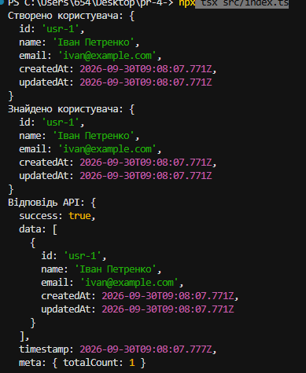
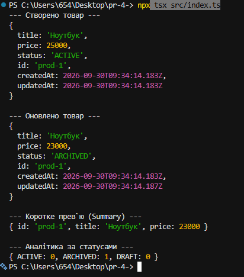
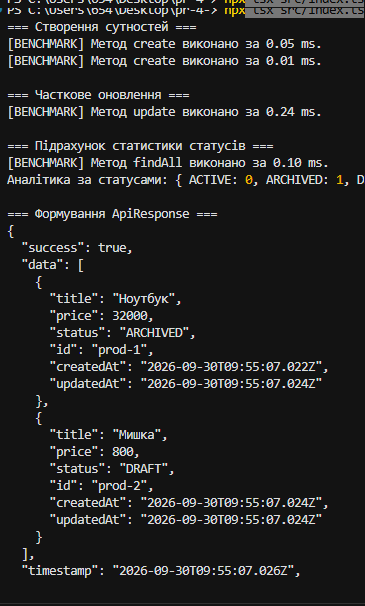
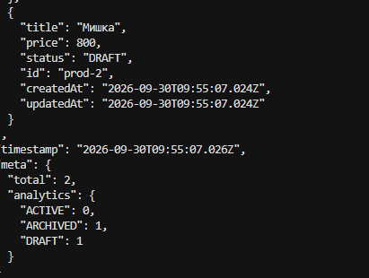

# Практична робота №3

## Узагальнення, декоратори та утиліти типів TypeScript

**Виконала:** Тирканич Корнелія
**Група:** КН-41
**Варіант:** 3

### Розрахунок варіанту

```text
((23 - 1) * 10 відс.) + 1 = 3.2
```

Отже, було обрано **3 варіант**.

---

## Мета роботи

Ознайомитися з можливостями TypeScript для створення строго типізованих та модульних програм. У ході роботи було опрацьовано **Generics**, **Utility Types**, **DTO**, **декоратори**, **Barrel Files** та реалізовано репозиторій для роботи з даними в пам'яті.

---

# Рівень 1. Generics та In-Memory Repository

### Налаштування проєкту

Було ініціалізовано TypeScript-проєкт та встановлено необхідні dev-залежності:

* `typescript`
* `tsx`
* `@types/node`

Також налаштовано `tsconfig.json` із суворим режимом типізації та підтримкою декораторів.

### Структура проєкту

Створено модульну структуру:

```text
src/
├── types/
├── repositories/
├── decorators/
└── index.ts
```

Для зручного імпорту модулів використано патерн **Barrel File** за допомогою `index.ts`.

### Generic-інтерфейси

Було створено такі універсальні типи:

* **`BaseEntity`** — базовий інтерфейс із обов'язковими полями `id`, `createdAt`, `updatedAt`.
* **`ApiResponse<TData>`** — універсальний тип для стандартизованої відповіді API.
* **`IRepository<T extends BaseEntity>`** — generic-контракт для CRUD-операцій з обмеженням типу через `extends`.

### In-Memory Repository

Реалізовано клас:

```text
InMemoryRepository<T>
```

Репозиторій зберігає дані у масиві та підтримує основні операції:

* `create()` — додавання нового запису;
* `findById()` — пошук за ідентифікатором;
* `findAll()` — отримання всіх записів;
* `deleteById()` — видалення запису.

Роботу репозиторію перевірено на сутності **User**.

### Результат

Усі CRUD-операції працюють коректно, а результати формуються у стандартизованому форматі `ApiResponse`.


---

# Рівень 2. Utility Types та DTO

На другому рівні було реалізовано трансформацію типів та створення DTO за допомогою вбудованих Utility Types TypeScript.

## EntityStatus

Створено `enum` зі статусами сутності:

```text
Active
Archived
Draft
```

## DTO та Utility Types

### `CreateDto<T>`

Використовує `Omit` для виключення системних полів:

```text
id
createdAt
updatedAt
```

Це дозволяє використовувати тип для створення нової сутності.

### `UpdateDto<T>`

Створено за допомогою:

```text
Partial<CreateDto<T>>
```

Усі поля стають необов'язковими, що дозволяє виконувати часткове оновлення сутності.

### `EntitySummary<T>`

Використовує `Pick` та залишає лише необхідні поля:

```text
id
title
price
```

Такий тип використовується для швидкого перегляду основної інформації.

### `EntityAnalytics`

За допомогою `Record` створено об'єкт для підрахунку кількості сутностей за кожним статусом.

## Оновлення репозиторію

До репозиторію додано метод:

```text
update()
```

Він:

* змінює передані поля;
* оновлює `updatedAt`;
* гарантує незмінність `id`.

### Результат

Програма успішно:

1. створила товар;
2. оновила його ціну;
3. змінила статус;
4. сформувала короткий зріз даних;
5. вивела аналітику статусів у консоль.

---

# Рівень 3. Метапрограмування та архітектурна модульність

На третьому рівні реалізовано декоратори та завершено модульну архітектуру проєкту.

## Декоратор `@LogExecutionTime()`

Створено декоратор методу, який:

* перехоплює виклик методу;
* вимірює час його виконання;
* використовує `performance.now()`;
* виводить результат у консоль.

Формат повідомлення:

```text
[BENCHMARK] Метод <Name> виконано за <Time> ms.
```

Це дозволяє контролювати продуктивність окремих методів програми.

## Декоратор `@FrozenEntity()`

Створено декоратор класу, який використовує:

```text
Object.freeze()
```

для конструктора та його прототипу.

Декоратор забезпечує захист сутності від модифікацій під час виконання програми (**runtime protection**).

---

## Barrel Files

Для централізованого реекспорту модулів створено `index.ts` у кожній основній папці:

```text
src/
├── types/
│   └── index.ts
├── repositories/
│   └── index.ts
├── decorators/
│   └── index.ts
└── index.ts
```

Це спрощує імпортування компонентів та робить структуру проєкту більш організованою.

---

# Інтеграційне тестування

У файлі `src/index.ts` проведено інтеграційне тестування всіх реалізованих можливостей.

Було:

* створено клас `Product`;
* застосовано декоратор `@FrozenEntity()`;
* створено `ProductRepository`;
* додано декоратор `@LogExecutionTime()` до методів `create`, `update`, `findAll`;
* створено декілька товарів;
* виконано оновлення ціни та статусу;
* підраховано статистику за `EntityStatus`;
* сформовано підсумковий об'єкт `ApiResponse`.


---

# Використані технології

| Технологія               | Призначення                   |
| ------------------------ | ----------------------------- |
| **TypeScript**           | Основна мова програмування    |
| **Generics**             | Створення універсальних типів |
| **Utility Types**        | Трансформація типів           |
| **Decorators**           | Метапрограмування             |
| **Node.js**              | Середовище виконання          |
| **tsx**                  | Запуск TypeScript             |
| **Barrel Files**         | Модульна організація проєкту  |
| **In-Memory Repository** | Робота з даними в пам'яті     |

---

# Результат роботи

У результаті виконання практичної роботи було створено строго типізований TypeScript-проєкт із модульною архітектурою.

Реалізовано:

* **Generics**;
* **In-Memory Repository**;
* CRUD-операції;
* **Utility Types** — `Omit`, `Partial`, `Pick`, `Record`;
* DTO для створення та оновлення сутностей;
* `EntityStatus`;
* декоратор `@LogExecutionTime()`;
* декоратор `@FrozenEntity()`;
* **Barrel Files**;
* інтеграційне тестування.

Програма працює без помилок та демонструє використання сучасних можливостей **TypeScript** для створення безпечного, структурованого та повторно використовуваного коду.

---

## Висновок

У ході виконання практичної роботи я опанувала ключові інструменти TypeScript. Навчилася проєктувати універсальні **Generics** та базовий `InMemoryRepository` для CRUD-операцій, застосовувати **Utility Types** (`Omit`, `Partial`, `Pick`, `Record`) для створення безпечних DTO та підрахунку статистики.
Також було реалізовано декоратори **`@LogExecutionTime`** та **`@FrozenEntity`**, які використовуються відповідно для логування продуктивності та захисту об'єктів від модифікації. Створена програма має чітку модульну структуру завдяки **Barrel Files**, використовує строгу типізацію та працює без помилок.
